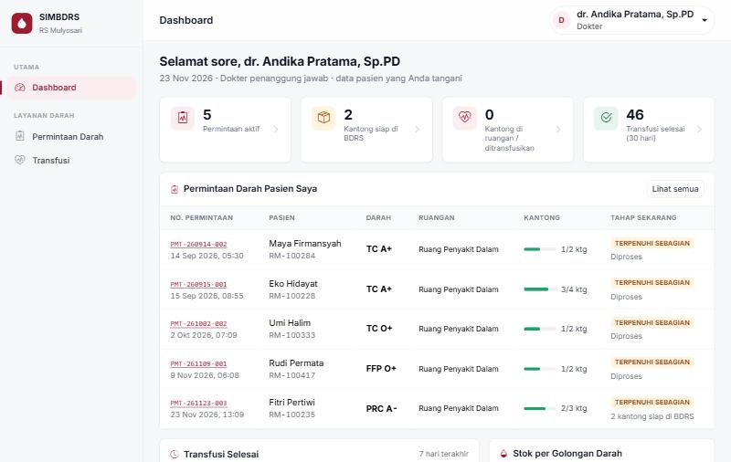
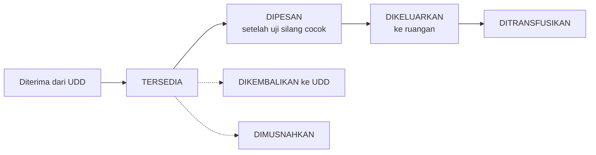

# SIMBDRS
**Sistem Informasi Manajemen Bank Darah Rumah Sakit**

SIMBDRS adalah aplikasi web untuk Bank Darah Rumah Sakit (BDRS). Aplikasi ini mencatat perjalanan setiap
kantong darah: diterima dari UDD PMI, disimpan, diminta ruangan, diuji silang, lalu ditransfusikan ke pasien.
Kantong yang tidak terpakai bisa dikembalikan ke UDD atau dimusnahkan.

Tugas mata kuliah **Manajemen Data**, Teknologi Kedokteran semester 3.

> ⚠️ **Semua data di repo ini fiktif.** Tidak ada data pasien sungguhan (UU No. 27 Tahun 2022 tentang
> Pelindungan Data Pribadi). Akun demo hanya untuk dicoba di komputer sendiri (localhost).



## Daftar Isi
1. [Masalah yang Diselesaikan](#masalah-yang-diselesaikan)
2. [Siapa Saja Penggunanya](#siapa-saja-penggunanya)
3. [Alur Kantong Darah](#alur-kantong-darah)
4. [Fitur](#fitur)
5. [Cara Instal](#cara-instal)
6. [Akun Demo](#akun-demo)
7. [Kalau Ada Masalah](#kalau-ada-masalah)
8. [Isi Repo](#isi-repo)

## Masalah yang Diselesaikan
- Pencatatan kantong darah masih manual, sehingga stok tidak diketahui secara langsung.
- Darah sering terbuang karena kedaluwarsa. Trombosit misalnya hanya tahan ±5 hari.
- Ruangan harus menelepon BDRS untuk tahu ketersediaan darah.

SIMBDRS menampilkan **stok real-time**, memberi **peringatan sebelum kedaluwarsa**, dan menyarankan kantong yang
paling dekat kedaluwarsa untuk dipakai lebih dulu (**FEFO**, *first expired, first out*).

## Siapa Saja Penggunanya
| Peran | Tugas di aplikasi |
|---|---|
| **Admin** | Mengelola data master, akun pengguna, **hak akses** tiap peran, dan melihat log aktivitas |
| **Petugas BDRS** | Menerima kantong dari UDD, memproses permintaan, uji silang, menyerahkan darah, mengembalikan/memusnahkan kantong |
| **Kepala BDRS** | Memantau stok, rekomendasi pemesanan, dan laporan |
| **Dokter** | Memantau permintaan dan transfusi **pasien yang ia tangani** |
| **Perawat** | Membuat permintaan darah dan mencatat transfusi **di ruangannya** |

Setiap peran punya dashboard sendiri. Hak setiap peran (Lihat / Tambah / Ubah / Hapus per menu) diatur Admin
di menu **Data Master → Hak Akses**, tidak ditulis mati di kode.

## Alur Kantong Darah

1. **Petugas** mencatat kantong yang datang dari UDD. Tanggal kedaluwarsa dihitung otomatis.
2. **Perawat** membuat permintaan darah untuk pasien dan memilih dokter penanggung jawab.
3. **Petugas** memilih kantong yang disarankan sistem (FEFO), lalu mencatat hasil uji silang.
4. Kantong yang cocok diserahkan ke ruangan.
5. **Perawat** mengetik ulang no. kantong dan No. RM pasien sebelum transfusi. Jika tidak cocok, sistem menolak.
6. **Dokter** memantau seluruh proses ini dari dashboard-nya.

## Fitur
- Login dengan password ter-*hash* dan hak akses per peran yang bisa diatur Admin.
- Data master: ruangan, dokter (sekaligus akun login), pasien, komponen darah, UDD, stok minimal, pengguna.
- Penerimaan kantong dan stok real-time per komponen, golongan darah, dan rhesus.
- Permintaan darah dengan saran kantong FEFO dan uji silang.
- Penyerahan dan transfusi dengan verifikasi ganda (no. kantong + No. RM).
- Pengembalian dan pemusnahan kantong beserta alasannya.
- Peringatan dini: kantong hampir kedaluwarsa dan stok di bawah minimum.
- Rekomendasi jumlah pemesanan ke UDD.
- Laporan (grafik, *wastage rate*, ekspor CSV, cetak/PDF) dan log aktivitas.

**Teknologi:** PHP 8 native + PDO, MySQL/MariaDB, Bootstrap 5, Chart.js. Dijalankan dengan XAMPP.

## Cara Instal
**Yang dibutuhkan:** laptop Windows dengan XAMPP (PHP 8.x).

1. **Pasang XAMPP** dari <https://www.apachefriends.org> di lokasi bawaan `C:\xampp`.
2. **Unduh kode** repo ini: klik tombol hijau **Code → Download ZIP**, lalu ekstrak.
   Bisa juga lewat Git: `git clone https://github.com/Zrest8/Simbdrs-Web.git`
3. **Salin folder `simbdrs`** (yang ada di dalam repo) ke `C:\xampp\htdocs\`. Hasilnya harus seperti ini:
   ```
   C:\xampp\htdocs\simbdrs\index.php
   ```
4. **Nyalakan server:** buka XAMPP Control Panel, klik **Start** pada **Apache** dan **MySQL**.
5. **Buat database:** buka <http://localhost/phpmyadmin>, pilih tab **Import**, lalu impor dua file ini **berurutan**:

   | Urutan | File | Isinya |
   |---|---|---|
   | 1 | `simbdrs/database/simbdrs.sql` | Database `simbdrs`, 17 tabel, akun dasar, hak akses bawaan |
   | 2 | `simbdrs/database/data_dummy.sql` | Data contoh 90 hari, akun dokter, dan akun perawat |

   > File pertama **menghapus** database `simbdrs` lama jika sudah ada.
6. **Buka aplikasi** di <http://localhost/simbdrs>, lalu login dengan akun demo di bawah.

## Akun Demo
| Peran | Username | Password |
|---|---|---|
| Admin | `admin` | `admin123` |
| Petugas BDRS | `petugas` | `petugas123` |
| Petugas BDRS 2 | `petugas2` | `petugas234` |
| Kepala BDRS | `kepala` | `kepala123` |
| Dokter | `dr.andika`, `dr.ratna`, `dr.hendra`, `dr.melati`, `dr.yusuf`, `dr.sari`, `dr.bambang` | `dokter123` |
| Perawat IGD | `igd` | `igd123` |
| Perawat ICU | `icu` | `icu12345` |
| Perawat Bedah | `bedah` | `bedah123` |
| Perawat Interna | `interna` | `interna123` |
| Perawat Anak | `anak` | `anak1234` |

Akun dokter, perawat selain `igd`, dan `petugas2` baru ada setelah `data_dummy.sql` diimpor.

## Kalau Ada Masalah
| Gejala | Penyebab & solusi |
|---|---|
| `Not Found` atau tampilan berantakan | Letak folder salah. Pastikan persis `C:\xampp\htdocs\simbdrs` |
| `Koneksi database gagal` | MySQL belum menyala atau `simbdrs.sql` belum diimpor |
| `Access denied for user 'root'` | MySQL di laptopmu memakai password. Isi di `simbdrs/config/koneksi.php` |
| Apache tidak mau Start | Port 80 dipakai program lain. Tutup program itu atau ganti port Apache |
| Menu tertentu tidak muncul | Peran itu tidak punya hak **Lihat**. Atur lewat akun Admin di menu **Hak Akses** |

## Isi Repo
```
├── simbdrs/            aplikasi web (disalin ke C:\xampp\htdocs\simbdrs)
│   ├── auth/           login, logout, pengecekan hak akses
│   ├── config/         pengaturan aplikasi & koneksi database
│   ├── includes/       fungsi bersama, menu, kerangka tampilan
│   ├── modules/        halaman per fitur (dashboard, permintaan, transfusi, ...)
│   ├── assets/         CSS & JavaScript
│   └── database/       simbdrs.sql, data_dummy.sql, pembuat data dummy
└── dokumen/
    ├── PRD.md          kebutuhan, fitur, dan aturan bisnis
    ├── ERD.md          diagram relasi tabel & kamus data
    └── gambar/         screenshot aplikasi
```

Penjelasan lengkap ada di [PRD](dokumen/PRD.md) dan [ERD](dokumen/ERD.md).
