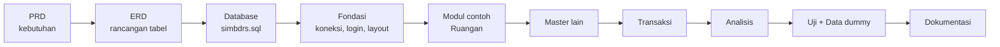

# Alur Pembuatan SIMBDRS — dari Nol sampai Jadi

> Dokumen ini menjawab satu pertanyaan: **"Aplikasi ini dibangun dengan urutan apa, dan kenapa urutannya begitu?"**
>
> Pasangan dokumen ini:
> - `PENJELASAN_SIMBDRS.md` → cara aplikasi **dipakai** (perjalanan kantong darah)
> - `PANDUAN_BELAJAR.md` → cara **kode** bekerja & phpMyAdmin
> - `PRD.md` / `ERD.md` → spesifikasi resmi fitur & tabel

**Isi**
0. Gambaran besar: membangun aplikasi = membangun rumah
1. Memahami masalah → PRD
2. Merancang data → ERD
3. Menyiapkan lingkungan (XAMPP)
4. Membuat database
5. Fondasi kode
6. Satu modul contoh: Master Ruangan
7. Data master lainnya
8. Modul transaksi (siklus hidup kantong)
9. Modul analisis
10. Pengujian
11. Data dummy
12. Dokumentasi
13. Penutup: jawaban singkat untuk dosen & latihan

---

## 0. Gambaran besar: membangun aplikasi = membangun rumah

| Tahap | Kalau membangun rumah | Di SIMBDRS | Hasilnya |
|---|---|---|---|
| 1 | Tahu kebutuhan penghuni | Memahami masalah bank darah & tugas dosen | `dokumen/PRD.md` |
| 2 | Gambar denah | Merancang tabel & relasinya | `dokumen/ERD.md`, proposal |
| 3 | Siapkan lahan & alat | Pasang XAMPP, siapkan folder | `http://localhost/simbdrs` |
| 4 | Fondasi | Buat database 16 tabel | `database/simbdrs.sql` |
| 5 | Kerangka & listrik | Koneksi, fungsi bersama, login, tampilan | `config/`, `includes/`, `auth/` |
| 6 | Satu kamar contoh | Modul Ruangan (pola CRUD) | `modules/master/ruangan/` |
| 7 | Kamar-kamar lain | 6 data master lain | `modules/master/*` |
| 8 | Ruang kerja utama | Modul transaksi | `penerimaan/` … `keluar/` |
| 9 | Ruang kontrol | Rekomendasi, laporan, log | `rekomendasi/`, `laporan/`, `log/` |
| 10 | Inspeksi bangunan | Uji tiap modul | (data uji dihapus lagi) |
| 11 | Perabot contoh | Data dummy 90 hari | `database/data_dummy.sql` |
| 12 | Buku manual | Dokumentasi | `dokumen/*.md` + PDF |

**Kunci memahaminya:** urutan ini mengikuti **ketergantungan**. Sesuatu baru bisa dibuat kalau hal yang dibutuhkannya sudah ada. Atap tidak bisa dipasang sebelum dinding; transfusi tidak bisa dibuat sebelum ada kantong darah.



---

## 1. Memahami masalah → PRD

**Bahan awal:** spesifikasi tugas dari dosen (`dokumen/README.md.pdf`).

**Pertanyaan yang dijawab sebelum menulis satu baris kode pun:**

- **Siapa penggunanya?** Ada 4 peran:

  | Peran | Siapa |
  |---|---|
  | ADMIN | Pengelola sistem |
  | PETUGAS | Petugas bank darah |
  | RUANGAN | Perawat di ruang rawat |
  | KEPALA | Kepala instalasi |

- **Masalah apa yang mau diselesaikan?** Darah terbuang karena kedaluwarsa, stok tidak real-time, dan pemesanan ke UDD masih berupa perkiraan.
- **Fitur apa saja yang perlu?** F-01 s.d. F-14.
- **Aturan apa yang tidak boleh dilanggar?** BR-01 s.d. BR-14 (BR = *business rule*). Contohnya:
  - BR-01: tanggal kedaluwarsa = tanggal aftap + masa simpan komponen.
  - BR-03: kantong yang sudah kedaluwarsa tidak boleh dipakai.
  - BR-04: golongan darah dan rhesus kantong harus persis sama dengan pasien.

**Hasil:** `dokumen/PRD.md`.

**Kenapa tahap ini duluan?** Tanpa daftar aturan, kita tidak tahu apa yang harus dicek oleh kode. Hampir setiap `if` di kode SIMBDRS bisa dirunut ke salah satu BR.

---

## 2. Merancang data → ERD

**Langkah 1. Daftar "benda" yang perlu dicatat (entitas).**
- Transaksi: kantong darah, penerimaan, permintaan, uji silang, transfusi, pengembalian, pemusnahan.
- Data master: ruangan, dokter, pasien, komponen, UDD, stok minimal, pengguna, pengaturan.
- Lainnya: log aktivitas.

**Langkah 2. Tentukan hubungan antar-benda (relasi).** Contoh:
- Satu penerimaan berisi **banyak** kantong (1 : N).
- Satu kantong hanya untuk **satu** transfusi (1 : 1, dijaga oleh UNIQUE).
- Satu permintaan bisa mendapat banyak kantong.

**Langkah 3. Tentukan siklus hidup kantong (6 status).**
```
TERSEDIA → DIPESAN → DIKELUARKAN → DITRANSFUSIKAN
    ├────→ DIKEMBALIKAN   (dikembalikan ke UDD)
    └────→ DIMUSNAHKAN    (kedaluwarsa / rusak)
```

**Hasil:** `dokumen/ERD.md` dan proposal. Rancangannya terdiri dari 16 tabel dengan 24 foreign key (awalnya 17 tabel; tabel `reaksi_transfusi` dihapus saat fitur hemovigilans dikeluarkan dari ruang lingkup).

**Kenapa sebelum kode?** Inti mata kuliah Manajemen Data ada di tahap ini. Kode PHP hanyalah "tangan" yang membaca dan menulis ke tabel. Kalau rancangan tabelnya salah, semua kode di atasnya ikut salah.

---

## 3. Menyiapkan lingkungan (XAMPP)

**Pembagian tugas XAMPP**, dengan analogi restoran:

| Komponen | Analogi | Tugas |
|---|---|---|
| Apache | Pelayan | Menerima permintaan dari browser |
| PHP | Koki | "Memasak" halaman HTML |
| MySQL/MariaDB | Gudang | Menyimpan data |

**Letak folder:**
- Kode disimpan di OneDrive (`Project Mandat\simbdrs`) supaya ter-backup.
- XAMPP hanya membaca folder `C:\xampp\htdocs`. Karena itu dibuat **junction** (semacam "pintu tembus") `C:\xampp\htdocs\simbdrs` yang menunjuk ke folder OneDrive tadi.
- Hasilnya: aplikasi terbuka di `http://localhost/simbdrs`, sementara file aslinya tetap di OneDrive.

---

## 4. Membuat database → `database/simbdrs.sql`

**Isi file:**
- `CREATE TABLE` untuk 16 tabel, lengkap dengan PRIMARY KEY, FOREIGN KEY, UNIQUE, dan ENUM untuk status.
- Data awal:
  - 4 komponen darah. Masa simpannya disimpan **di tabel, bukan di kode**, supaya kalau angkanya berubah, cukup diubah di database.
  - Pengaturan periode pemesanan.
  - Akun contoh, dengan password yang disimpan sebagai `password_hash` (tidak pernah teks asli).

Contoh potongan aturan yang dijaga langsung oleh database:
```sql
CREATE TABLE transfusi (
  id_transfusi INT AUTO_INCREMENT PRIMARY KEY,
  id_kantong   INT NOT NULL UNIQUE,      -- BR-06: satu kantong = satu transfusi
  ...
  FOREIGN KEY (id_kantong) REFERENCES kantong_darah(id_kantong)
);
```

**Cara pakai:** file ini diimpor lewat phpMyAdmin (tab *Import*).

**Kenapa sebelum halaman web?** Halaman web hanya membaca dan menulis tabel. Kalau tabelnya belum ada, tidak ada yang bisa dikerjakan.

---

## 5. Fondasi kode (dipakai SEMUA halaman)

| File | Tugas | Analogi |
|---|---|---|
| `config/app.php` | Nama aplikasi, `BASE_URL` | Papan nama |
| `config/koneksi.php` | Membuka koneksi PDO ke MySQL (`$pdo`) | Pintu ke gudang |
| `includes/fungsi.php` | Fungsi bersama, lihat daftar di bawah | Kotak perkakas |
| `auth/login.php`, `auth/logout.php` | Masuk/keluar, `password_verify`, session | Satpam di gerbang |
| `auth/cek_akses.php` → `wajib_login([...])` | Cek sudah login + peran boleh | Satpam di tiap pintu ruangan |
| `includes/header.php`, `sidebar.php`, `menu.php`, `footer.php` | Kerangka tampilan, menu sesuai peran | Dinding & lorong |

**Isi kotak perkakas `includes/fungsi.php`:**

| Fungsi | Gunanya |
|---|---|
| `e()` | Mengamankan teks sebelum ditampilkan (anti XSS) |
| `url()`, `redirect()` | Membuat alamat halaman & pindah halaman |
| `pengguna()` | Data pengguna yang sedang login |
| `set_flash()` | Pesan "berhasil/gagal" yang muncul sekali |
| `csrf_field()`, `cek_csrf()` | Anti formulir palsu dari situs lain |
| `catat_log()` | Menulis jejak audit ke `log_aktivitas` (BR-12) |
| `tgl_indo()` | Format tanggal Indonesia |
| `nama_role()`, `badge_status_kantong()`, `teks_sisa_hari()` | Bantuan tampilan |

**Urutan file yang dimuat saat satu halaman dibuka:**
```
modules/x/index.php
  └─ require auth/cek_akses.php
        └─ require includes/fungsi.php
              └─ require config/app.php + config/koneksi.php   → $pdo siap
  └─ wajib_login(['PETUGAS', ...])   → belum login? ke login.php. Peran salah? "Akses ditolak"
  └─ query data (prepared statement)
  └─ require includes/header.php     (+ sidebar & menu)
  └─ isi halaman
  └─ require includes/footer.php
```

Satpam di tiap pintu, diambil dari `auth/cek_akses.php`:
```php
function wajib_login(array $peran_boleh = []): array
{
    $p = pengguna();
    if (!$p) {                                   // belum login
        set_flash('warning', 'Silakan login terlebih dahulu.');
        redirect('auth/login.php');
    }
    if ($peran_boleh && !in_array($p['role'], $peran_boleh, true)) {
        http_response_code(403);                 // login, tapi perannya tidak boleh
        // ... tampilkan halaman "Akses ditolak" ...
        exit;
    }
    return $p;
}
```

**Kenapa fondasi dibuat sebelum modul?** Semua modul memakai file-file ini. Kalau setiap modul menulis sendiri koneksi dan cek login-nya, kodenya akan berulang-ulang dan mudah ada yang terlewat.

---

## 6. Satu modul contoh: Master Ruangan (pola CRUD)

CRUD = **C**reate (tambah), **R**ead (lihat), **U**pdate (ubah), **D**elete (hapus).

| File | Tugas |
|---|---|
| `index.php` | Daftar ruangan |
| `tambah.php` | Tambah ruangan |
| `edit.php` | Ubah ruangan |
| `_form.php` | Formulir yang dipakai bersama oleh tambah & edit |
| `hapus.php` | Hapus. Kalau ruangan sudah dipakai (foreign key menolak), ruangan **dinonaktifkan** (`aktif = 0`), bukan dihapus |

**Alur satu formulir memakai pola PRG** (*Post → Redirect → Get*):
```
Buka tambah.php (GET)  → tampil formulir (_form.php)
Klik Simpan (POST)     → cek_csrf()               ← tolak formulir palsu
                       → validasi isian (kosong? terlalu panjang?)
                       → INSERT ... VALUES (?)    ← prepared statement, anti SQL injection
                       → catat_log()              ← jejak audit
                       → set_flash('Berhasil')
                       → redirect ke index.php    ← refresh tidak mengirim ulang data
```

Kode aslinya, diambil dari `modules/master/ruangan/tambah.php`:
```php
require __DIR__ . '/../../../auth/cek_akses.php';
wajib_login(['ADMIN']);                       // hanya ADMIN

if ($_SERVER['REQUEST_METHOD'] === 'POST') {
    cek_csrf();
    $nama = trim($_POST['nama_ruangan'] ?? '');
    if ($nama === '') {
        $error = 'Nama ruangan wajib diisi.';
    } else {
        try {
            $stmt = $pdo->prepare("INSERT INTO ruangan (nama_ruangan) VALUES (?)");
            $stmt->execute([$nama]);
            catat_log($pdo, 'TAMBAH', 'ruangan', (int) $pdo->lastInsertId(), "Tambah ruangan: $nama");
            set_flash('success', "Ruangan \"$nama\" berhasil ditambahkan.");
            header('Location: index.php');
            exit;
        } catch (PDOException $ex) {
            if ($ex->getCode() === '23000') {  // 23000 = melanggar UNIQUE
                $error = "Ruangan \"$nama\" sudah ada.";
            } else {
                throw $ex;
            }
        }
    }
}
```

**Kenapa satu modul dulu?** Setelah satu pola benar dan teruji, modul lain tinggal mengikuti. Hasilnya lebih cepat, lebih konsisten, dan lebih mudah dijelaskan.

---

## 7. Data master lainnya

**Modul yang dibuat:** Dokter, Pasien, Komponen, UDD, Stok Minimal, Pengguna. Semuanya ada di `modules/master/*` dan mengikuti pola Ruangan.

**Kenapa sebelum transaksi?** Transaksi **menunjuk** ke data master lewat foreign key:
- Permintaan darah butuh pasien, ruangan, dan dokter.
- Penerimaan butuh UDD dan komponen.

Kalau data masternya belum ada, formulir transaksi tidak punya pilihan untuk diisi.

**Contoh aturan khas tiap modul:**
- **Pasien:** No. RM unik; golongan darah dan rhesus harus diisi berpasangan.
- **Pengguna:** admin terakhir tidak bisa dihapus, supaya sistem tidak terkunci.
- **Stok Minimal:** diisi sebagai matriks (komponen × golongan) dan disimpan dalam satu transaksi.

---

## 8. Modul transaksi — mengikuti siklus hidup kantong

| Urutan | Modul (`modules/…`) | Status kantong | Aturan utama |
|---|---|---|---|
| ① | `penerimaan` | → TERSEDIA | BR-01 hitung kedaluwarsa, BR-02 no. kantong unik |
| ② | `stok` | (hanya membaca) | FEFO, BR-08 hampir kedaluwarsa, BR-09 di bawah minimum |
| ③④⑤ | `permintaan` + uji silang | TERSEDIA ⇄ DIPESAN | BR-03, 04, 05, 07, 11, 13, 14 |
| ⑥⑦ | `transfusi` | → DIKELUARKAN → DITRANSFUSIKAN | BR-06, verifikasi no. kantong + No. RM |
| ⑧ | `keluar` | → DIKEMBALIKAN / DIMUSNAHKAN | Hanya dari TERSEDIA |

> FEFO = *First Expired, First Out*: kantong yang paling cepat kedaluwarsa dipakai lebih dulu.

**Kenapa urutannya begini?** Setiap modul butuh data dari modul sebelumnya. Transfusi tidak bisa diuji kalau belum ada kantong berstatus DIPESAN, dan kantong tidak bisa DIPESAN kalau belum ada penerimaan.

**Teknik penting yang baru muncul di tahap ini:**

1. **Transaksi database:** beberapa tabel diubah sekaligus, dan hasilnya berhasil semua atau batal semua.
   ```php
   $pdo->beginTransaction();
   // INSERT transfusi ...  +  UPDATE kantong_darah ...  +  catat_log ...
   $pdo->commit();          // kalau ada error di tengah → rollBack(), tidak ada yang tersimpan
   ```
2. **`UPDATE … WHERE status = 'lama'` lalu cek `rowCount()`:** mencegah klik ganda atau dua petugas memproses kantong yang sama.
   ```php
   $st = $pdo->prepare("UPDATE kantong_darah SET status = 'DIKELUARKAN'
                        WHERE id_kantong = ? AND status = 'DIPESAN'");
   $st->execute([$id]);
   if ($st->rowCount() !== 1) { /* sudah diproses orang lain → batalkan */ }
   ```
3. **`SELECT … FOR UPDATE`:** mengunci baris selama sedang diproses.
4. **Validasi ulang di server:** isian dari browser bisa dipalsukan, jadi server mengecek lagi. Contohnya: apakah golongan kantong cocok, apakah kantong belum kedaluwarsa, dan apakah ruangan itu memang milik perawat yang login.

---

## 9. Modul analisis (hanya membaca data)

| Modul | Isi |
|---|---|
| `rekomendasi` | Saran pemesanan ke UDD (BR-10): ⌈rata-rata pemakaian per hari × periode⌉ + stok minimal − stok tersedia |
| `laporan` | Rekap per periode, *wastage rate* (musnah ÷ diterima), grafik per bulan, unduh CSV, cetak/PDF |
| `log` | Jejak audit, hanya bisa dibaca dan hanya untuk ADMIN, termasuk catatan login gagal |

Pengaturan periode untuk rekomendasi diubah ADMIN di `modules/master/stok_minimal/pengaturan.php`, tanpa menyentuh kode.

**Kenapa terakhir?** Modul ini merangkum data dari transaksi. Tanpa transaksi, tidak ada yang bisa dihitung.

---

## 10. Pengujian tiap modul

Setiap modul selesai dibuat, langsung diuji dengan pola yang sama:

1. Masukkan **data uji sementara** lewat skrip.
2. Coba **jalur normal**: apakah hasilnya benar?
3. Coba **jalur salah**: isian kosong, tanggal di masa depan, data duplikat.
4. Coba **formulir palsu**: kantong golongan lain, kantong kedaluwarsa, ruangan lain.
5. Coba **hak akses**: login dengan peran yang tidak berhak.
6. **Hapus lagi** data ujinya, supaya database tetap bersih.

**Contoh bug yang ketemu berkat pengujian:**

| Bug | Penyebab | Perbaikan |
|---|---|---|
| Halaman Rekomendasi & Pengembalian error | Nama kolom salah: `batas_hari_peringatan` | Diganti ke nama yang benar: `batas_peringatan_hari` |
| Pesan "harus antara 1–60" kehilangan angka | PHP membaca `$min–` sebagai satu nama variabel | Ditulis `{$min}–{$maks}` |
| Perawat menekan "Mulai" di menit yang sama dengan penyerahan, lalu ditolak | Jam penyerahan punya detik, jam mulai tidak | Perbandingan dibulatkan per menit |

**Pelajarannya:** kode yang "kelihatannya benar" belum tentu benar. Bug baru kelihatan ketika kode benar-benar dijalankan.

---

## 11. Data dummy

- **Pembuatnya:** skrip `database/buat_data_dummy.php`. Skrip ini **mensimulasikan 90 hari** operasional bank darah (kantong datang, diminta, ditransfusikan, sebagian kedaluwarsa) sambil menaati semua aturan bisnis.
- **Hasilnya:** `database/data_dummy.sql`, dengan tanggal relatif terhadap waktu impor (`NOW() - INTERVAL …`). Jadi data selalu terlihat "baru" kapan pun diimpor.
- **Pemeriksaan:** hasilnya dicek dengan 13 query SQL, misalnya "ada transfusi setelah kedaluwarsa?" dan "ada golongan yang tidak cocok?". Semua menghasilkan 0 pelanggaran.
- **Isinya fiktif semua:** sesuai UU 27/2022 tentang Pelindungan Data Pribadi, tidak ada data pasien asli.
- **Keamanan:** folder `database/` diberi `.htaccess` (`Require all denied`), jadi file SQL tidak bisa diunduh lewat browser.

**Kenapa di akhir?** Data dummy harus mengikuti aturan yang sudah final di kode. Kalau dibuat lebih awal, setiap aturan berubah, datanya harus dibuat ulang.

---

## 12. Dokumentasi

| Dokumen | Menjawab pertanyaan |
|---|---|
| `PRD.md` | Apa yang harus dibuat? |
| `ERD.md` | Bagaimana datanya disusun? |
| `Proposal_SIMBDRS.docx` | Kenapa proyek ini penting? (Bab I–III) |
| `PENJELASAN_SIMBDRS.md` | Bagaimana aplikasi dipakai? (perjalanan kantong) |
| `PANDUAN_BELAJAR.md` | Bagaimana kodenya bekerja? |
| **`ALUR_PEMBUATAN_SIMBDRS.md`** | **Bagaimana aplikasi dibangun dari nol?** (dokumen ini) |

---

## 13. Penutup

### Jawaban 30 detik kalau dosen bertanya "Bagaimana proses pembuatannya?"

> "Kami mulai dari **kebutuhan dan aturan bisnis** (PRD), lalu **merancang 16 tabel dan relasinya** (ERD) dan membuat databasenya. Setelah itu kami membangun **fondasi**: koneksi, login, dan hak akses per peran. Kami membuat **satu modul contoh** (Ruangan) sebagai pola CRUD, lalu membangun **data master**, kemudian **modul transaksi mengikuti siklus hidup kantong darah** dari penerimaan sampai transfusi atau pemusnahan, lalu **modul analisis** (rekomendasi, laporan, log). Tiap modul **langsung diuji**, termasuk dengan formulir palsu dan peran yang salah. Terakhir kami mengisi **data dummy 90 hari** untuk demo."

### Latihan supaya benar-benar paham (±20 menit)

1. Buka `simbdrs/modules/master/ruangan/tambah.php`.
2. Ikuti setiap fungsi yang dipanggil, satu per satu:
   - `wajib_login` → ada di `auth/cek_akses.php`
   - `cek_csrf`, `catat_log`, `set_flash` → ada di `includes/fungsi.php`
3. Buka phpMyAdmin, tambah satu ruangan lewat aplikasi, lalu lihat isi tabel `ruangan` dan `log_aktivitas`. Baris baru muncul di keduanya.
4. Buka `simbdrs/modules/transfusi/aksi.php`. Cari pola yang sama (`wajib_login`, `cek_csrf`, `prepare`, `catat_log`, `redirect`), ditambah yang baru: `beginTransaction` dan `rowCount()`.

Kalau langkah 4 sudah terasa "oh, ini mirip yang tadi", berarti alur pembuatannya sudah dipahami.
