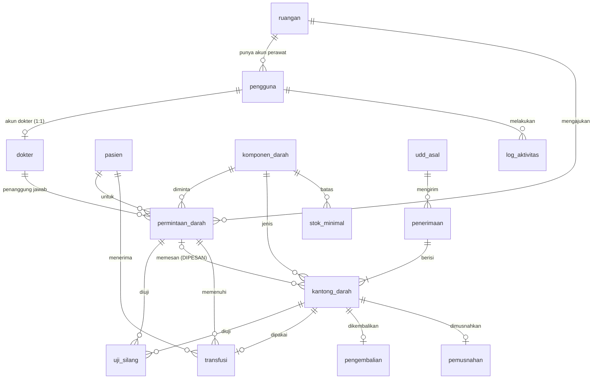

# ERD & Kamus Data — SIMBDRS

Database: `simbdrs` · Engine: **InnoDB** (agar foreign key berfungsi) · Charset: `utf8mb4` · Collation: `utf8mb4_general_ci`
File SQL: [`../simbdrs/database/simbdrs.sql`](../simbdrs/database/simbdrs.sql)

## Perubahan dari draf README
| # | Perubahan | Alasan |
|---|---|---|
| 1 | `stok_minimal.id` → `id_stok_minimal` | Konsisten dengan konvensi `id_<nama_tabel>` |
| 2 | Kolom `pengembalian.id_udd` **dihapus** | UDD asal sudah bisa dibaca lewat `kantong_darah → penerimaan.id_udd`. Menyimpan ulang = redundansi (prinsip normalisasi README bagian 12). Jika dosen/BDRS mengizinkan kantong dikembalikan ke UDD lain, kolom ini bisa ditambahkan lagi. |
| 3 | Tabel baru **`pengaturan`** | BR-10 butuh "periode pemesanan hari". Angka aturan tidak boleh di-hardcode, jadi disimpan di sini dan bisa diubah admin. |
| 4 | Kolom `aktif` pada `ruangan`, `dokter`, `udd_asal`, `pasien`, `pengguna` | Data master yang sudah dipakai transaksi tidak dihapus, cukup dinonaktifkan (menjaga integritas riwayat). |
| 5 | `created_at` hanya di `pengguna` | Tabel transaksi sudah punya kolom waktu kejadiannya sendiri (`tgl_terima`, `tgl_permintaan`, `tgl_uji`, `tgl_keluar_bdrs`, …), dan setiap perubahan tercatat di `log_aktivitas.waktu`. |
| 6 | Tabel `reaksi_transfusi` dan kolom `transfusi.ada_reaksi` **dihapus** (11 Nov 2026) | Fitur hemovigilans dikeluarkan dari ruang lingkup agar project tetap sederhana. |
| 7 | `dokter` dihubungkan ke `pengguna` (kolom `id_pengguna` NOT NULL UNIQUE); kolom `nama_dokter` & `aktif` dipindah ke `pengguna` (23 Nov 2026, masukan dosen) | Setiap dokter yang tampil di sistem **wajib punya akun** (relasi 1:1) supaya tidak rancu. Nama dan status aktif cukup disimpan sekali di `pengguna` (normalisasi). |
| 8 | Peran `RUANGAN` dipecah menjadi `DOKTER` dan `PERAWAT` (23 Nov 2026) | Dokter dan perawat punya dashboard sendiri. Satu akun per perawat, terikat ke satu ruangan. |
| 9 | Tabel baru **`hak_akses`** (23 Nov 2026, masukan dosen) | Hak akses per peran per menu (lihat/tambah/ubah/hapus) disimpan di database sehingga Admin bisa mengubahnya dari menu **Hak Akses**, tanpa mengubah kode. |

Total: **17 tabel** (16 dari draf README + `pengaturan` + `hak_akses` − `reaksi_transfusi`), **25 foreign key**.

## Diagram ERD

> Agar diagram tetap terbaca, relasi **pengguna → tabel transaksi** tidak digambar. Tabel `pengguna` (1) terhubung ke banyak (N) baris di
> `penerimaan`, `permintaan_darah`, `uji_silang`, `transfusi`, `pengembalian`, dan `pemusnahan`
> sebagai pencatat/petugas (kolom `id_petugas`, `id_peminta`, `id_pencatat`).

## Kelompok tabel
| Kelompok | Tabel |
|---|---|
| Master | `ruangan`, `udd_asal`, `komponen_darah`, `pasien`, `pengguna`, `dokter`, `stok_minimal`, `pengaturan` |
| Hak akses | `hak_akses` (tidak ber-FK: `kunci_menu` mengacu ke daftar menu di `includes/menu.php`) |
| Transaksi stok | `penerimaan`, `kantong_darah` |
| Layanan pasien | `permintaan_darah`, `uji_silang`, `transfusi` |
| Kantong keluar | `pengembalian`, `pemusnahan` |
| Tata kelola | `log_aktivitas` |

**Urutan pembuatan** (tabel induk dulu, baru anak yang punya FK):
`ruangan → udd_asal → komponen_darah → pasien → pengguna → dokter → hak_akses → stok_minimal → pengaturan → penerimaan → permintaan_darah → kantong_darah → uji_silang → transfusi → pengembalian → pemusnahan → log_aktivitas`

---

## Kamus Data

### Master

**ruangan** — daftar ruangan RS yang bisa meminta darah
| Kolom | Tipe | Ket. |
|---|---|---|
| id_ruangan | INT PK AI | |
| nama_ruangan | VARCHAR(100) UNIQUE | IGD, ICU, Bedah, ... |
| aktif | TINYINT(1) | default 1 |

**dokter** — dokter penanggung jawab permintaan (BR-14). Setiap dokter **wajib punya akun** (`pengguna` ber-peran `DOKTER`).
Nama & status aktif dibaca dari `pengguna`. Dibuat lewat menu Master Dokter (akun + data dokter dalam satu transaksi).
| Kolom | Tipe | Ket. |
|---|---|---|
| id_dokter | INT PK AI | |
| id_pengguna | INT FK NOT NULL UNIQUE → pengguna | akun login dokter (relasi 1:1) |
| spesialis | VARCHAR(100) NULL | |

**udd_asal** — UDD/UTD PMI pengirim darah
| Kolom | Tipe | Ket. |
|---|---|---|
| id_udd | INT PK AI | |
| nama_udd | VARCHAR(100) UNIQUE | |
| alamat | VARCHAR(255) NULL | |
| telepon | VARCHAR(20) NULL | |
| aktif | TINYINT(1) | default 1 |

**komponen_darah** — data referensi aturan medis
| Kolom | Tipe | Ket. |
|---|---|---|
| id_komponen | INT PK AI | |
| kode | VARCHAR(10) UNIQUE | WB, PRC, TC, FFP |
| nama_komponen | VARCHAR(100) | |
| suhu_min, suhu_max | DECIMAL(4,1) | °C |
| masa_simpan_hari | INT | BR-01 |
| batas_peringatan_hari | INT | BR-08 |

**pasien**
| Kolom | Tipe | Ket. |
|---|---|---|
| id_pasien | INT PK AI | |
| no_rm | VARCHAR(20) UNIQUE | nomor rekam medis (fiktif) |
| nama_pasien | VARCHAR(100) | |
| tgl_lahir | DATE | |
| jenis_kelamin | ENUM('L','P') | |
| gol_darah | ENUM('A','B','AB','O') NULL | wajib sebelum permintaan diproses (BR-13) |
| rhesus | ENUM('+','-') NULL | |
| aktif | TINYINT(1) | default 1 |

**pengguna**
| Kolom | Tipe | Ket. |
|---|---|---|
| id_pengguna | INT PK AI | |
| nama | VARCHAR(100) | |
| username | VARCHAR(50) UNIQUE | |
| password_hash | VARCHAR(255) | hasil `password_hash()` |
| role | ENUM('ADMIN','PETUGAS','KEPALA','DOKTER','PERAWAT') | akun `DOKTER` hanya dibuat lewat Master Dokter |
| id_ruangan | INT FK NULL → ruangan | wajib jika role = PERAWAT (dicek di PHP) |
| aktif | TINYINT(1) | default 1 |
| created_at | DATETIME | default sekarang |

**hak_akses** — siapa boleh apa, diatur Admin di menu **Hak Akses**
| Kolom | Tipe | Ket. |
|---|---|---|
| role | ENUM(sama dengan `pengguna.role`) | PK (bersama `kunci_menu`) |
| kunci_menu | VARCHAR(30) | PK; kunci menu di `includes/menu.php`, mis. `permintaan` |
| lihat | TINYINT(1) | boleh membuka menu (menu tampil di sidebar) |
| tambah | TINYINT(1) | mis. buat permintaan, terima kantong |
| ubah | TINYINT(1) | mis. proses permintaan, catat transfusi |
| hapus | TINYINT(1) | mis. batalkan permintaan, hapus data master |

Aksi selain `lihat` hanya berlaku bila `lihat = 1`. Hak Admin atas menu Pengguna & Hak Akses dikunci di kode
(`HAK_TERKUNCI`) agar Admin tidak bisa mengunci dirinya sendiri keluar. Dashboard selalu bisa dibuka semua peran.

**stok_minimal** — batas stok per kombinasi (BR-09)
| Kolom | Tipe | Ket. |
|---|---|---|
| id_stok_minimal | INT PK AI | |
| id_komponen | INT FK → komponen_darah | |
| gol_darah | ENUM('A','B','AB','O') | |
| rhesus | ENUM('+','-') | |
| jumlah_minimal | INT | |
| | UNIQUE(id_komponen, gol_darah, rhesus) | satu batas per kombinasi |

**pengaturan** — angka aturan yang bisa diubah admin
| Kolom | Tipe | Ket. |
|---|---|---|
| kunci | VARCHAR(50) PK | mis. `periode_pemesanan_hari` |
| nilai | VARCHAR(100) | |
| keterangan | VARCHAR(255) NULL | |

### Transaksi stok

**penerimaan** — satu kiriman dari UDD (header)
| Kolom | Tipe | Ket. |
|---|---|---|
| id_penerimaan | INT PK AI | |
| no_dokumen | VARCHAR(50) | surat jalan UDD |
| id_udd | INT FK → udd_asal | |
| tgl_terima | DATETIME | |
| suhu_terima | DECIMAL(4,1) NULL | |
| id_petugas | INT FK → pengguna | |
| catatan | TEXT NULL | |

**kantong_darah** — ⭐ tabel inti, satu baris = satu kantong
| Kolom | Tipe | Ket. |
|---|---|---|
| id_kantong | INT PK AI | |
| no_kantong | VARCHAR(30) UNIQUE | BR-02, benang merah penelusuran |
| id_penerimaan | INT FK → penerimaan | → UDD asal |
| id_komponen | INT FK → komponen_darah | |
| gol_darah | ENUM('A','B','AB','O') | |
| rhesus | ENUM('+','-') | |
| volume_ml | INT | |
| tgl_aftap | DATE | tanggal pengambilan di UDD |
| tgl_kedaluwarsa | DATE | BR-01, dihitung PHP saat simpan |
| status | ENUM('TERSEDIA','DIPESAN','DIKELUARKAN','DITRANSFUSIKAN','DIKEMBALIKAN','DIMUSNAHKAN') | default TERSEDIA |
| id_permintaan_dipesan | INT FK NULL → permintaan_darah | terisi saat DIPESAN |

Index: `(status, id_komponen, gol_darah, rhesus, tgl_kedaluwarsa)` → mempercepat query pencocokan FEFO dan stok.
CHECK: `tgl_kedaluwarsa >= tgl_aftap`.

### Layanan pasien

**permintaan_darah**
| Kolom | Tipe | Ket. |
|---|---|---|
| id_permintaan | INT PK AI | |
| no_permintaan | VARCHAR(30) UNIQUE | |
| id_pasien | INT FK → pasien | |
| id_ruangan | INT FK → ruangan | BR-11 |
| id_peminta | INT FK → pengguna | yang menginput |
| id_dokter | INT FK → dokter | BR-14 |
| id_komponen | INT FK → komponen_darah | |
| jumlah_kantong | INT | CHECK `jumlah_kantong > 0` |
| urgensi | ENUM('BIASA','CITO') | |
| diagnosis | VARCHAR(255) | |
| tgl_permintaan | DATETIME | |
| status | ENUM('MENUNGGU','DIPROSES','TERPENUHI_SEBAGIAN','TERPENUHI','DIBATALKAN') | default MENUNGGU |

**uji_silang** — hasil crossmatch (riwayat, termasuk yang TIDAK_COCOK)
| Kolom | Tipe | Ket. |
|---|---|---|
| id_uji | INT PK AI | |
| id_permintaan | INT FK → permintaan_darah | |
| id_kantong | INT FK → kantong_darah | |
| hasil | ENUM('COCOK','TIDAK_COCOK') | BR-07 |
| tgl_uji | DATETIME | |
| id_petugas | INT FK → pengguna | |
| catatan | TEXT NULL | |

**transfusi**
| Kolom | Tipe | Ket. |
|---|---|---|
| id_transfusi | INT PK AI | |
| id_kantong | INT FK UNIQUE → kantong_darah | BR-06 (satu kantong satu transfusi) |
| id_permintaan | INT FK → permintaan_darah | |
| id_pasien | INT FK → pasien | |
| tgl_keluar_bdrs | DATETIME | saat DIKELUARKAN |
| tgl_mulai, tgl_selesai | DATETIME NULL | diisi ruangan |
| id_pencatat | INT FK → pengguna | |

### Kantong keluar

**pengembalian**
| Kolom | Tipe | Ket. |
|---|---|---|
| id_pengembalian | INT PK AI | |
| id_kantong | INT FK UNIQUE → kantong_darah | |
| tgl_kembali | DATETIME | |
| alasan | VARCHAR(255) | |
| id_petugas | INT FK → pengguna | |

**pemusnahan**
| Kolom | Tipe | Ket. |
|---|---|---|
| id_pemusnahan | INT PK AI | |
| id_kantong | INT FK UNIQUE → kantong_darah | |
| tgl_musnah | DATETIME | |
| alasan | ENUM('KEDALUWARSA','RUSAK','HEMOLISIS','LAINNYA') | |
| keterangan | TEXT NULL | |
| id_petugas | INT FK → pengguna | |

### Tata kelola

**log_aktivitas** — audit trail (BR-12)
| Kolom | Tipe | Ket. |
|---|---|---|
| id_log | INT PK AI | |
| id_pengguna | INT FK NULL → pengguna | pelaku (dari session); NULL untuk `LOGIN_GAGAL` karena belum login — akun yang dicoba disimpan di `id_data` |
| aksi | VARCHAR(50) | `LOGIN`, `LOGIN_GAGAL`, `LOGOUT`, `TAMBAH`, `UBAH` (termasuk perubahan hak akses), `HAPUS`, `NONAKTIF`, `TERIMA`, `UJI_SILANG`, `STATUS`, `BATAL`, `MULAI`, `TOLAK` |
| nama_tabel | VARCHAR(50) NULL | |
| id_data | INT NULL | |
| keterangan | TEXT NULL | mis. `TERSEDIA → DIPESAN` |
| waktu | DATETIME | default sekarang |

---

## Aturan FK (ON DELETE)
Semua FK memakai **`ON DELETE RESTRICT`** (bawaan): data induk yang sudah dipakai tidak bisa dihapus.
Ini sengaja — riwayat transfusi tidak boleh hilang. Master cukup dinonaktifkan (`aktif = 0`).
## Nilai yang masih perlu diverifikasi
| Data | Nilai sementara | Status |
|---|---|---|
| Masa simpan FFP | 365 hari | `TODO: verifikasi` (Permenkes 91/2015) |
| `batas_peringatan_hari` WB / PRC / TC / FFP | 7 / 7 / 2 / 30 | `TODO: verifikasi` dengan dosen/referensi |
| Kompatibilitas golongan selain "sama persis" | tidak diterapkan | `TODO: verifikasi` (BR-04) |
