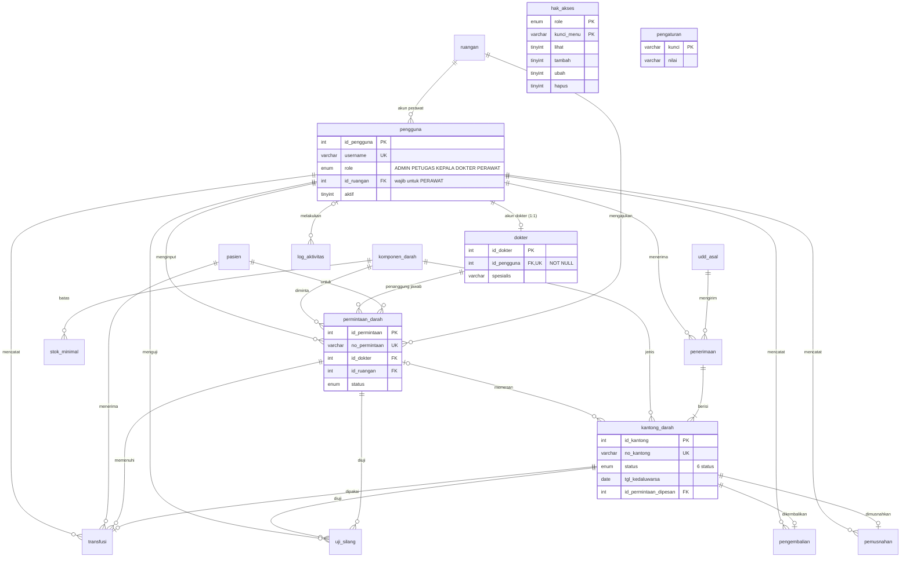

# ERD & Kamus Data — SIMBDRS

| Item | Keterangan |
|---|---|
| Database | `simbdrs` · engine **InnoDB** · charset `utf8mb4` |
| Jumlah | **17 tabel, 25 foreign key** |
| File SQL | [`simbdrs/database/simbdrs.sql`](../simbdrs/database/simbdrs.sql) |
| Versi | 2.0 — 23 November 2026 |

## 1. Perubahan Versi 2.0 (masukan dosen)
| Perubahan | Alasan |
|---|---|
| `dokter` dihubungkan ke `pengguna` lewat `id_pengguna` (NOT NULL, UNIQUE). Kolom nama & status aktif dokter dipindah ke `pengguna` | Setiap dokter **wajib punya akun** (relasi 1:1). Nama tidak disimpan dua kali sehingga tidak rancu |
| `pengguna.role`: peran `RUANGAN` diganti `DOKTER` dan `PERAWAT` | Dokter dan perawat punya dashboard dan hak sendiri |
| Tabel baru `hak_akses` | Hak setiap peran disimpan di database sehingga Admin bisa mengubahnya tanpa mengubah kode |

## 2. Diagram ERD

Tabel `hak_akses` dan `pengaturan` berdiri sendiri (tanpa foreign key): `hak_akses.kunci_menu` mengacu ke
daftar menu di `includes/menu.php`, sedangkan `pengaturan` menyimpan angka aturan seperti periode pemesanan.

| Kelompok | Tabel |
|---|---|
| Master (8) | `ruangan`, `udd_asal`, `komponen_darah`, `pasien`, `pengguna`, `dokter`, `stok_minimal`, `pengaturan` |
| Transaksi (7) | `penerimaan`, `kantong_darah`, `permintaan_darah`, `uji_silang`, `transfusi`, `pengembalian`, `pemusnahan` |
| Tata kelola (2) | `log_aktivitas`, `hak_akses` |

## 3. Kamus Data
Singkatan: PK = primary key, FK = foreign key, UK = unique, AI = auto increment.
Kolom `aktif` (TINYINT, default 1) dipakai untuk menonaktifkan data master yang sudah punya riwayat, bukan menghapusnya.

### Master
**ruangan** — ruangan RS yang meminta darah

| Kolom | Tipe | Keterangan |
|---|---|---|
| id_ruangan | INT PK AI | |
| nama_ruangan | VARCHAR(100) UK | IGD, ICU, ... |
| aktif | TINYINT(1) | |

**udd_asal** — UDD/UTD PMI pengirim darah

| Kolom | Tipe | Keterangan |
|---|---|---|
| id_udd | INT PK AI | |
| nama_udd | VARCHAR(100) UK | |
| alamat, telepon | VARCHAR NULL | |
| aktif | TINYINT(1) | |

**komponen_darah** — jenis komponen (WB, PRC, TC, FFP)

| Kolom | Tipe | Keterangan |
|---|---|---|
| id_komponen | INT PK AI | |
| kode | VARCHAR(10) UK | |
| nama_komponen | VARCHAR(100) | |
| suhu_min, suhu_max | DECIMAL(4,1) NULL | suhu simpan |
| masa_simpan_hari | INT | BR-01 |
| batas_peringatan_hari | INT | BR-08 |

**pasien**

| Kolom | Tipe | Keterangan |
|---|---|---|
| id_pasien | INT PK AI | |
| no_rm | VARCHAR(20) UK | nomor rekam medis |
| nama_pasien | VARCHAR(100) | fiktif |
| tgl_lahir | DATE | |
| jenis_kelamin | ENUM('L','P') | |
| gol_darah, rhesus | ENUM NULL | wajib sebelum permintaan (BR-13) |
| aktif | TINYINT(1) | |

**pengguna** — akun login semua peran

| Kolom | Tipe | Keterangan |
|---|---|---|
| id_pengguna | INT PK AI | |
| nama | VARCHAR(100) | |
| username | VARCHAR(50) UK | |
| password_hash | VARCHAR(255) | hasil `password_hash()` |
| role | ENUM('ADMIN','PETUGAS','KEPALA','DOKTER','PERAWAT') | |
| id_ruangan | INT FK NULL → ruangan | wajib untuk PERAWAT (BR-11) |
| aktif | TINYINT(1) | akun nonaktif tidak bisa login |
| created_at | DATETIME | |

**dokter** — dokter penanggung jawab; setiap dokter wajib punya akun

| Kolom | Tipe | Keterangan |
|---|---|---|
| id_dokter | INT PK AI | |
| id_pengguna | INT FK UK NOT NULL → pengguna | akun login dokter (1:1, BR-15) |
| spesialis | VARCHAR(100) NULL | |

**stok_minimal** — batas minimal per komponen + golongan + rhesus (BR-09)

| Kolom | Tipe | Keterangan |
|---|---|---|
| id_stok_minimal | INT PK AI | |
| id_komponen | INT FK → komponen_darah | |
| gol_darah, rhesus | ENUM | UK bersama id_komponen |
| jumlah_minimal | INT | |

**pengaturan** — angka aturan yang bisa diubah Admin

| Kolom | Tipe | Keterangan |
|---|---|---|
| kunci | VARCHAR(50) PK | mis. `periode_pemesanan_hari` |
| nilai | VARCHAR(100) | |
| keterangan | VARCHAR(255) NULL | |

### Transaksi
**penerimaan** — satu kiriman dari UDD

| Kolom | Tipe | Keterangan |
|---|---|---|
| id_penerimaan | INT PK AI | |
| no_dokumen | VARCHAR(50) | surat jalan |
| id_udd | INT FK → udd_asal | |
| tgl_terima | DATETIME | |
| suhu_terima | DECIMAL(4,1) NULL | |
| id_petugas | INT FK → pengguna | |
| catatan | TEXT NULL | |

**kantong_darah** — tabel inti; satu baris = satu kantong

| Kolom | Tipe | Keterangan |
|---|---|---|
| id_kantong | INT PK AI | |
| no_kantong | VARCHAR(30) UK | BR-02 |
| id_penerimaan | INT FK → penerimaan | |
| id_komponen | INT FK → komponen_darah | |
| gol_darah, rhesus | ENUM | |
| volume_ml | INT | |
| tgl_aftap | DATE | |
| tgl_kedaluwarsa | DATE | = tgl_aftap + masa simpan (BR-01) |
| status | ENUM('TERSEDIA','DIPESAN','DIKELUARKAN','DITRANSFUSIKAN','DIKEMBALIKAN','DIMUSNAHKAN') | |
| id_permintaan_dipesan | INT FK NULL → permintaan_darah | terisi saat DIPESAN (BR-07) |

**permintaan_darah**

| Kolom | Tipe | Keterangan |
|---|---|---|
| id_permintaan | INT PK AI | |
| no_permintaan | VARCHAR(30) UK | format PMT-YYMMDD-NNN |
| id_pasien | INT FK → pasien | |
| id_ruangan | INT FK → ruangan | BR-11 |
| id_peminta | INT FK → pengguna | perawat yang menginput |
| id_dokter | INT FK → dokter | penanggung jawab (BR-14) |
| id_komponen | INT FK → komponen_darah | |
| jumlah_kantong | INT | > 0 |
| urgensi | ENUM('BIASA','CITO') | |
| diagnosis | VARCHAR(255) | |
| tgl_permintaan | DATETIME | |
| status | ENUM('MENUNGGU','DIPROSES','TERPENUHI_SEBAGIAN','TERPENUHI','DIBATALKAN') | |

**uji_silang** — hasil crossmatch kantong untuk satu permintaan

| Kolom | Tipe | Keterangan |
|---|---|---|
| id_uji | INT PK AI | |
| id_permintaan | INT FK → permintaan_darah | |
| id_kantong | INT FK → kantong_darah | |
| hasil | ENUM('COCOK','TIDAK_COCOK') | |
| tgl_uji | DATETIME | |
| id_petugas | INT FK → pengguna | |
| catatan | TEXT NULL | |

**transfusi**

| Kolom | Tipe | Keterangan |
|---|---|---|
| id_transfusi | INT PK AI | |
| id_kantong | INT FK UK → kantong_darah | satu kantong satu pasien (BR-06) |
| id_permintaan | INT FK → permintaan_darah | |
| id_pasien | INT FK → pasien | |
| tgl_keluar_bdrs | DATETIME | saat diserahkan |
| tgl_mulai, tgl_selesai | DATETIME NULL | dicatat perawat |
| id_pencatat | INT FK → pengguna | |

**pengembalian** — kantong dikembalikan ke UDD

| Kolom | Tipe | Keterangan |
|---|---|---|
| id_pengembalian | INT PK AI | |
| id_kantong | INT FK UK → kantong_darah | |
| tgl_kembali | DATETIME | |
| alasan | VARCHAR(255) | |
| id_petugas | INT FK → pengguna | |

**pemusnahan**

| Kolom | Tipe | Keterangan |
|---|---|---|
| id_pemusnahan | INT PK AI | |
| id_kantong | INT FK UK → kantong_darah | |
| tgl_musnah | DATETIME | |
| alasan | ENUM('KEDALUWARSA','RUSAK','HEMOLISIS','LAINNYA') | |
| keterangan | TEXT NULL | wajib bila LAINNYA |
| id_petugas | INT FK → pengguna | |

### Tata kelola
**log_aktivitas** — jejak setiap tindakan (BR-12)

| Kolom | Tipe | Keterangan |
|---|---|---|
| id_log | INT PK AI | |
| id_pengguna | INT FK NULL → pengguna | NULL untuk login gagal |
| aksi | VARCHAR(50) | LOGIN, TAMBAH, UBAH, STATUS, ... |
| nama_tabel, id_data | VARCHAR / INT NULL | data yang diubah |
| keterangan | TEXT NULL | mis. `TERSEDIA → DIPESAN` |
| waktu | DATETIME | |

**hak_akses** — hak tiap peran di tiap menu, diatur Admin

| Kolom | Tipe | Keterangan |
|---|---|---|
| role | ENUM (sama dengan `pengguna.role`) | PK gabungan |
| kunci_menu | VARCHAR(30) | PK gabungan; mis. `permintaan` |
| lihat | TINYINT(1) | menu tampil & bisa dibuka |
| tambah | TINYINT(1) | mis. membuat permintaan |
| ubah | TINYINT(1) | mis. memproses permintaan, mencatat transfusi |
| hapus | TINYINT(1) | mis. membatalkan permintaan |

Aksi Tambah/Ubah/Hapus hanya berlaku bila Lihat bernilai 1.

## 4. Aturan Foreign Key
Semua foreign key memakai `ON DELETE RESTRICT`: data induk yang sudah dipakai tidak bisa dihapus, sehingga
riwayat transfusi tidak pernah hilang. Data master seperti ini cukup dinonaktifkan (`aktif = 0`).
