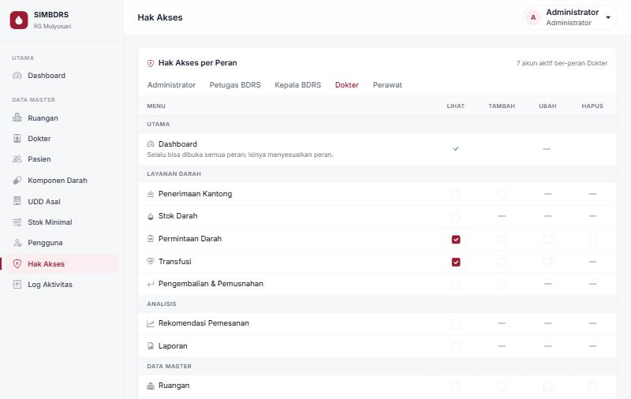
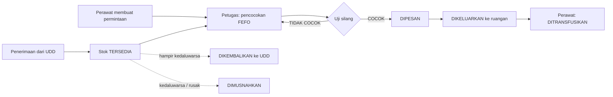
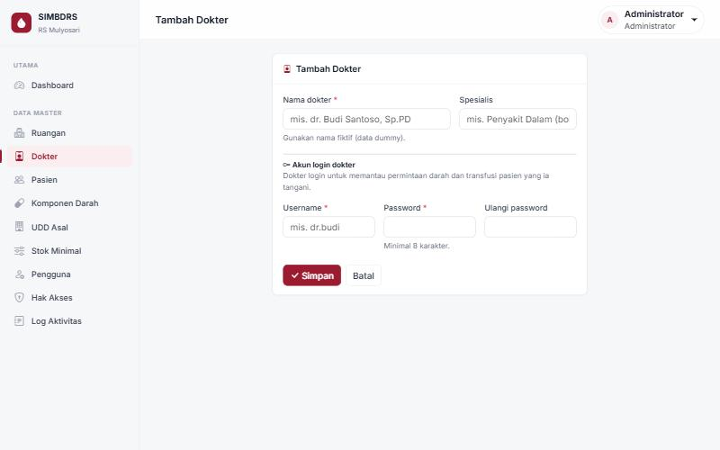
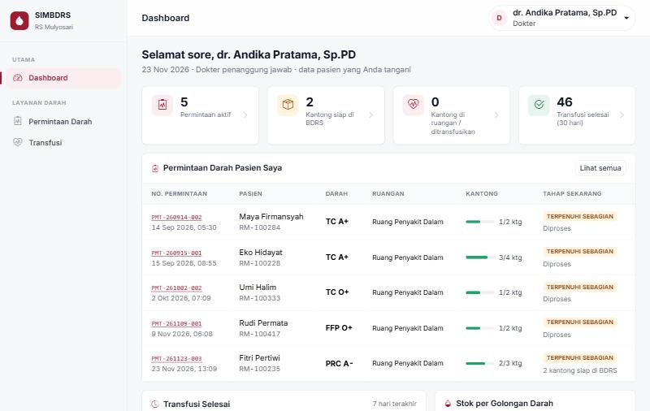
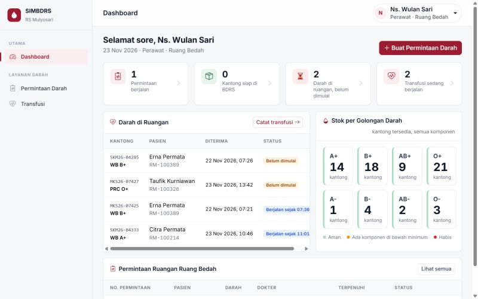

# PRD — SIMBDRS
**Sistem Informasi Manajemen Bank Darah Rumah Sakit**

| Item | Keterangan |
|---|---|
| Mata kuliah | Manajemen Data — Teknologi Kedokteran, semester 3 |
| Jenis produk | Aplikasi web prototipe (PHP native + PDO, MySQL/MariaDB, XAMPP) |
| Versi | 2.0 — 23 November 2026 (revisi masukan dosen: akun dokter, master hak akses, dashboard dokter & perawat) |

---

## 1. Latar Belakang
Bank Darah Rumah Sakit (BDRS) mengelola kantong darah dari UDD PMI sampai ditransfusikan ke pasien.
Masalah yang ingin diselesaikan:

| Masalah | Dampak |
|---|---|
| Kebutuhan darah nasional ±5,6 juta kantong/tahun, tersedia ±4,4 juta (defisit ±21%) | Setiap kantong berharga |
| Trombosit hanya tahan ±5 hari; 36,17% TC di UDD PMI Kota Yogyakarta (2024) dimusnahkan | Biaya terbuang (BPPD ±Rp490.000/kantong) dan limbah B3 |
| Pencatatan manual, stok tidak real-time (Markoyo, 2023) | Ruangan harus menelepon BDRS, data tercecer |
| Belum ada peringatan kedaluwarsa & stok minimal (Yanto dkk., 2025) | Darah terbuang sebelum dipakai |

## 2. Tujuan
1. Setiap kantong darah **terlacak** dari diterima sampai ditransfusikan, dikembalikan, atau dimusnahkan.
2. **Mengurangi darah terbuang** lewat peringatan dini kedaluwarsa dan pemakaian FEFO (*first expired, first out*).
3. **Stok real-time** per komponen, golongan, dan rhesus, serta rekomendasi jumlah pemesanan ke UDD.
4. Setiap pengguna hanya bisa mengakses data dan fitur yang **sesuai haknya**.

Indikator keberhasilan yang ditampilkan sistem: *wastage rate* (kantong dimusnahkan ÷ kantong diterima),
stok per golongan, dan log aktivitas untuk setiap perubahan status kantong.

## 3. Pengguna & Hak Akses
| Peran | Siapa | Hak bawaan |
|---|---|---|
| **Admin** | Pengelola sistem | Data master, akun pengguna, **hak akses**, log aktivitas |
| **Petugas BDRS** | Petugas bank darah | Penerimaan kantong, proses permintaan & uji silang, penyerahan, pengembalian, pemusnahan |
| **Kepala BDRS** | Kepala unit | Stok, rekomendasi pemesanan, laporan (hanya baca) |
| **Dokter** | Dokter penanggung jawab | Memantau permintaan & transfusi **pasien yang ia tangani** (hanya baca) |
| **Perawat** | Perawat ruangan (satu akun per perawat) | Membuat permintaan darah dan mencatat transfusi **di ruangannya** |

**Ketentuan akun dan hak akses:**
- **Setiap dokter wajib punya akun.** Akun dibuat otomatis saat Admin menambah dokter di menu Dokter,
  sehingga semua dokter yang tampil di sistem pasti bisa login (tidak ada data dokter tanpa akun).
- **Hak akses diatur Admin, bukan di kode.** Di menu *Hak Akses*, Admin mencentang **Lihat / Tambah / Ubah / Hapus**
  untuk setiap menu dan setiap peran. Perubahan langsung berlaku: menu di samping dan tombol aksi ikut menyesuaikan.
- Hak Admin atas menu *Pengguna* dan *Hak Akses* dikunci agar Admin tidak mengunci dirinya sendiri.

*Gambar 1. Halaman Hak Akses: Admin mengatur hak peran Dokter per menu.*

## 4. Ruang Lingkup
**Termasuk:** data master, penerimaan kantong, stok, permintaan darah, pencocokan FEFO, uji silang, penyerahan,
transfusi, pengembalian, pemusnahan, peringatan dini, rekomendasi pemesanan, laporan, log aktivitas,
hak akses, dashboard per peran.

**Tidak termasuk:** data pendonor & uji saring IMLTD (ranah UDD), integrasi SIMDONDAR/SATUSEHAT, jejaring antar-RS,
persetujuan dokter terpisah, pemantauan suhu kulkas harian, pelaporan reaksi transfusi (hemovigilans).

## 5. Alur Utama

Status kantong hanya boleh berpindah mengikuti panah di atas. Status akhir (DITRANSFUSIKAN, DIKEMBALIKAN,
DIMUSNAHKAN) tidak bisa diubah lagi. Dokter penanggung jawab memantau seluruh proses ini dari dashboard-nya.

## 6. Kebutuhan Fungsional
| Kode | Fitur | Kriteria utama |
|---|---|---|
| F-01 | Login & hak akses | Password di-*hash*; akun nonaktif ditolak; menu dan tombol mengikuti tabel `hak_akses`; halaman tanpa hak → "Akses ditolak" |
| F-02 | Data master | Ruangan, dokter (+ akun login), pasien, komponen, UDD, stok minimal, pengguna; data yang sudah dipakai cukup dinonaktifkan |
| F-03 | Penerimaan kantong | Satu penerimaan berisi banyak kantong; tanggal kedaluwarsa dihitung otomatis |
| F-04 | Stok real-time | Hanya kantong TERSEDIA yang belum kedaluwarsa; indikator aman / hampir kedaluwarsa / habis |
| F-05 | Permintaan darah | Perawat memilih pasien, **dokter penanggung jawab**, komponen, jumlah, urgensi (BIASA/CITO) |
| F-06 | FEFO + uji silang | Sistem menyarankan kantong cocok urut kedaluwarsa terdekat; hanya hasil COCOK yang bisa dipesan |
| F-07 | Penyerahan & transfusi | Sebelum transfusi, perawat mengetik ulang no. kantong dan No. RM; tidak cocok → ditolak |
| F-08 | Pengembalian & pemusnahan | Hanya dari status TERSEDIA, alasan wajib diisi |
| F-09 | Peringatan dini | Kantong hampir kedaluwarsa dan stok di bawah minimum tampil di dashboard |
| F-11 | Rekomendasi pemesanan | Jumlah pesan dihitung dari pemakaian 30 hari + stok minimal − stok tersedia |
| F-12 – F-14 | Laporan & log | Grafik pemakaian, *wastage rate*, ekspor CSV/PDF, log aktivitas |
| F-16 | Dashboard dokter | Permintaan pasien yang ia tangani beserta tahapnya, transfusi selesai 7 hari terakhir |
| F-17 | Dashboard perawat | Permintaan ruangannya, darah di ruangan yang perlu dicatat, tombol "Buat Permintaan" |

*Gambar 2. Form Tambah Dokter sekaligus membuat akun login dokter.*

*Gambar 3. Dashboard Dokter: hanya pasien yang ia tangani.*

*Gambar 4. Dashboard Perawat: data ruangannya sendiri.*

## 7. Aturan Bisnis
| Kode | Aturan |
|---|---|
| BR-01 | Tanggal kedaluwarsa = tanggal aftap + masa simpan komponen (otomatis) |
| BR-02 | Nomor kantong unik |
| BR-03 | Kantong yang sudah kedaluwarsa tidak boleh dipesan atau dikeluarkan |
| BR-04 | Golongan ABO + rhesus sama persis, komponen sesuai permintaan |
| BR-05 | Saran kantong diurutkan dari kedaluwarsa terdekat (FEFO) |
| BR-06 | Satu kantong hanya untuk satu pasien |
| BR-07 | Kantong menjadi DIPESAN hanya jika uji silangnya COCOK |
| BR-08 | Peringatan jika sisa hari ≤ batas peringatan komponen |
| BR-09 | Peringatan jika stok tersedia < stok minimal |
| BR-10 | Rekomendasi = ⌈rata-rata pemakaian harian 30 hari × periode pesan⌉ + stok minimal − stok tersedia (minimal 0) |
| BR-11 | Perawat hanya mengakses data ruangannya; dokter hanya data pasien yang ia tangani |
| BR-12 | Setiap perubahan status kantong dan hak akses tercatat di log aktivitas |
| BR-13 | Golongan darah pasien wajib terisi sebelum permintaan dibuat |
| BR-14 | Permintaan wajib mencantumkan dokter penanggung jawab |
| BR-15 | Setiap dokter wajib punya tepat satu akun login |

Angka aturan (masa simpan, batas peringatan, stok minimal, periode pemesanan) disimpan di database dan bisa diubah Admin.

## 8. Kebutuhan Non-Fungsional
- **Keamanan:** semua query memakai *prepared statement* PDO; password `password_hash()`; cek sesi dan hak akses di setiap halaman; token CSRF di setiap form.
- **Integritas data:** InnoDB dengan foreign key, UNIQUE, dan ENUM; operasi yang menyentuh beberapa tabel memakai transaksi.
- **Privasi:** hanya data fiktif (UU No. 27/2022 tentang Pelindungan Data Pribadi).
- **Kemudahan:** antarmuka Bootstrap 5 berbahasa Indonesia, dirancang untuk layar laptop.

## 9. Data
Database `simbdrs` berisi **17 tabel dan 25 foreign key** (rinci di [`ERD.md`](ERD.md)).
Data uji adalah data **fiktif** hasil simulasi 90 hari operasional BDRS: 5 ruangan, 7 dokter, 42 pasien,
±545 kantong, ±185 permintaan.
