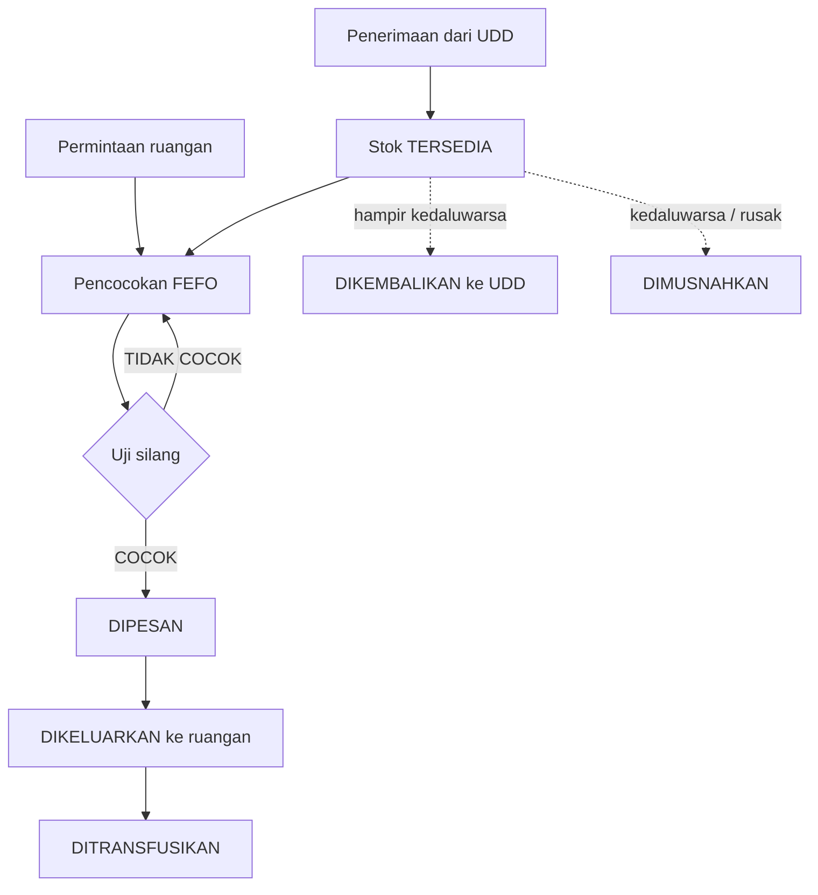
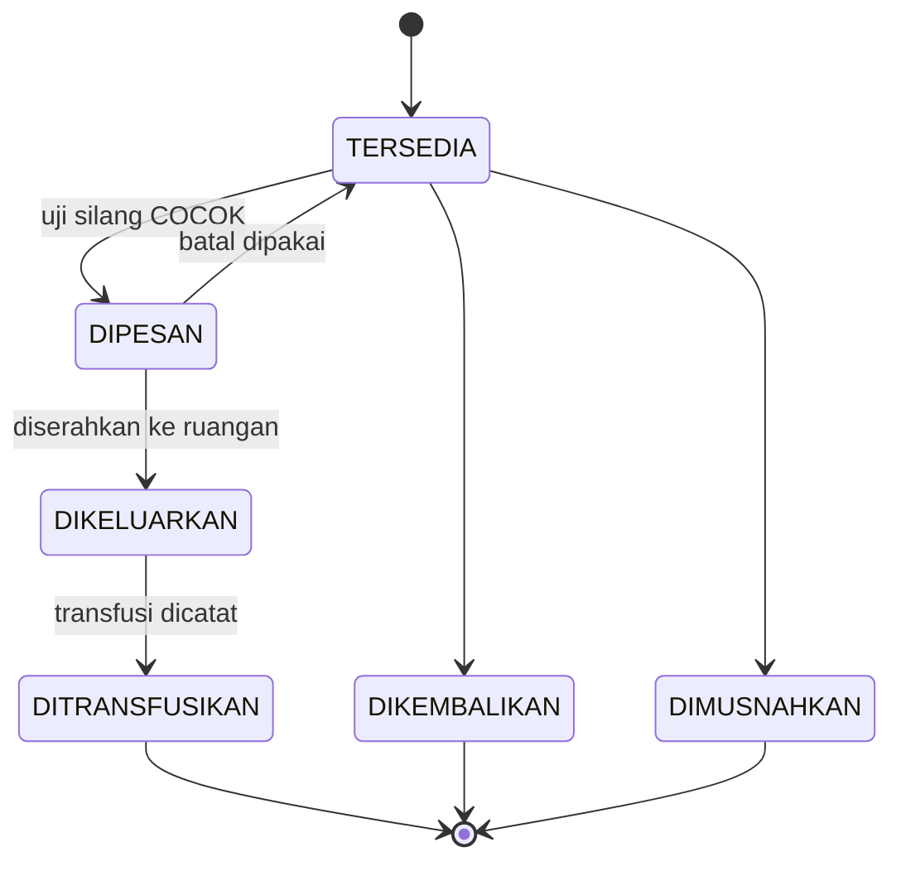

# PRD — SIMBDRS
**Sistem Informasi Manajemen Bank Darah Rumah Sakit**

| Item | Keterangan |
|---|---|
| Mata kuliah | Manajemen Data — Teknologi Kedokteran, semester 3 |
| Jenis produk | Aplikasi web prototipe (XAMPP, PHP native + PDO, MySQL/MariaDB) |
| Sumber | `README.md.pdf` (spesifikasi awal) |
| Versi | 1.1 (11 Nov 2026: F-10 hemovigilans & F-15 suhu kulkas dikeluarkan; disesuaikan dengan aplikasi jadi) |

---

## 1. Ringkasan
SIMBDRS membantu **Bank Darah Rumah Sakit (BDRS)** mengelola kantong darah sejak diterima dari UDD PMI
sampai ditransfusikan ke pasien. Pembedanya dibanding sistem BDRS lain:

1. **Peringatan dini kedaluwarsa + FEFO**: kantong yang hampir kedaluwarsa ditandai dan disarankan dipakai lebih dulu atau dikembalikan.
2. **Rekomendasi pemesanan berbasis data**: jumlah kantong yang perlu dipesan dihitung dari pemakaian 30 hari terakhir dan stok minimal.

## 2. Masalah
| Masalah | Dampak |
|---|---|
| Kebutuhan darah nasional ±5,6 juta kantong/tahun, tersedia ±4,4 juta (defisit ±21%) | Setiap kantong berharga |
| Trombosit hanya bertahan ±5 hari; 36,17% TC di UDD PMI Kota Yogyakarta (2024) dimusnahkan | Pemborosan biaya (BPPD ±Rp490.000/kantong) dan limbah B3 |
| Pencatatan manual, stok tidak real-time (Markoyo, 2023) | Ruangan harus menelepon BDRS, data tercecer |
| Belum ada notifikasi kedaluwarsa & stok minimal (saran Yanto dkk., 2025) | Darah terbuang sebelum sempat dipakai |

## 3. Tujuan & Metrik Keberhasilan
| Tujuan | Indikator yang bisa ditampilkan sistem |
|---|---|
| Mengurangi darah terbuang | **Wastage rate** = kantong dimusnahkan ÷ kantong diterima, per komponen per bulan |
| Stok terpantau real-time | Stok per komponen × golongan × rhesus selalu sesuai status kantong |
| Permintaan cepat terpenuhi | Rata-rata waktu dari permintaan dibuat sampai darah diserahkan (dipisah BIASA/CITO). *Datanya tersimpan (`tgl_permintaan`, `tgl_keluar_bdrs`), tetapi belum ditampilkan di halaman Laporan.* |
| Setiap kantong terlacak | 100% kantong berstatus akhir punya data turunan (transfusi / pengembalian / pemusnahan) |
| Data terjaga | Semua perubahan status tercatat di log aktivitas |

## 4. Pengguna & Hak Akses
| Peran | Siapa | Hak akses |
|---|---|---|
| `ADMIN` | Pengelola sistem | Akun pengguna, data master, pengaturan, **hak akses** |
| `PETUGAS` | Petugas BDRS | Penerimaan, proses permintaan, uji silang, penyerahan, pengembalian, pemusnahan |
| `KEPALA` | Kepala BDRS | Dashboard, laporan, rekomendasi pemesanan (hanya baca) |
| `DOKTER` | Dokter penanggung jawab | Dashboard dokter: memantau permintaan & transfusi **pasien yang ia tangani** (hanya baca) |
| `PERAWAT` | Perawat ruangan (satu akun per perawat) | Dashboard perawat, buat permintaan darah, catat transfusi — **hanya ruangannya sendiri** |

Tabel di atas adalah hak **bawaan**. Hak sebenarnya disimpan di tabel `hak_akses` (per peran × per menu × aksi
Lihat/Tambah/Ubah/Hapus) dan bisa diubah Admin lewat menu **Hak Akses** tanpa mengubah kode. Setiap dokter wajib
punya akun; akun dokter dibuat otomatis saat Admin menambah dokter di Master Dokter.

## 5. Ruang Lingkup
**Termasuk:** penerimaan kantong, stok, permintaan, pencocokan FEFO, uji silang, penyerahan, transfusi,
pengembalian, pemusnahan, peringatan dini, rekomendasi pemesanan, laporan, log aktivitas.

**Tidak termasuk:** data pendonor & uji saring IMLTD (ranah UDD), jejaring antar-RS, integrasi SIMDONDAR/SATUSEHAT,
perhitungan hasil lab (sistem hanya mencatat hasil crossmatch), modul persetujuan dokter terpisah,
pemantauan suhu kulkas harian (F-15), hemovigilans / pelaporan reaksi transfusi (F-10).

## 6. Alur Utama

### Siklus status kantong

Perpindahan status di luar panah di atas **ditolak sistem**. Status akhir tidak bisa diubah.

## 7. Kebutuhan Fungsional (User Story + Kriteria Penerimaan)

### 🟢 MVP
**F-01 Login & hak akses** — *Sebagai pengguna, saya login agar hanya melihat menu sesuai peran.*
- Username/password salah atau kosong → ditolak dengan pesan.
- Password disimpan dengan `password_hash()`; akun `aktif = 0` tidak bisa login.
- Membuka halaman di luar peran → diarahkan/ditolak.
- Menu di sidebar dan tombol aksi (tambah/ubah/hapus) mengikuti tabel `hak_akses`.
- Admin bisa mengubah hak setiap peran di menu **Hak Akses** (centang Lihat/Tambah/Ubah/Hapus per menu); perubahan langsung berlaku dan tercatat di log.
- Dokter dan perawat punya dashboard sendiri: dokter melihat pasien yang ia tangani, perawat melihat ruangannya.

**F-02 Data master** — *Sebagai admin, saya mengelola ruangan, dokter, komponen, UDD, pasien, pengguna, stok minimal.*
- CRUD lengkap; data yang sudah dipakai transaksi tidak bisa dihapus (dinonaktifkan saja).
- `no_rm` dan `username` unik; pengguna `PERAWAT` wajib punya ruangan.
- Menambah dokter = membuat akun login dokter sekaligus (satu transaksi); akun dokter tidak bisa dibuat/dihapus dari menu Pengguna.

**F-03 Penerimaan kantong** — *Sebagai petugas, saya mencatat kantong yang datang dari UDD.*
- Satu penerimaan (no. dokumen, UDD, tanggal, suhu) berisi banyak kantong.
- `tgl_kedaluwarsa` dihitung otomatis (BR-01); `no_kantong` duplikat ditolak (BR-02).
- Kantong baru berstatus `TERSEDIA`.

**F-04 Stok real-time** — *Sebagai petugas/kepala, saya melihat stok per komponen, golongan, rhesus.*
- Hanya menghitung kantong `TERSEDIA` yang belum kedaluwarsa.
- Indikator warna: 🟢 aman, 🟡 ≤ batas peringatan, 🔴 kedaluwarsa.

**F-05 Permintaan darah** — *Sebagai perawat, saya mengajukan permintaan darah untuk pasien; dokter penanggung jawab memantaunya.*
- Wajib: pasien (golongan darah terisi, BR-13), dokter penanggung jawab (BR-14), komponen, jumlah, urgensi.
- Perawat hanya melihat permintaan ruangannya; dokter hanya melihat permintaan pasien yang ia tangani (BR-11).

**F-06 Pencocokan FEFO + uji silang** — *Sebagai petugas, saya memilih kantong yang cocok dan mencatat crossmatch.*
- Sistem menampilkan kantong cocok (BR-04) urut kedaluwarsa terdekat (BR-05), tanpa kantong kedaluwarsa (BR-03).
- Hasil `COCOK` → kantong `DIPESAN` untuk permintaan itu (BR-07); `TIDAK_COCOK` tetap tercatat.
- Status permintaan diperbarui (DIPROSES / TERPENUHI_SEBAGIAN / TERPENUHI).

**F-07 Penyerahan & transfusi** — *Petugas menyerahkan darah; perawat mencatat transfusi.*
- Penyerahan → `DIKELUARKAN` + baris `transfusi` dibuat; kantong kedaluwarsa tidak bisa diserahkan (BR-03).
- Sebelum mulai, perawat mengetik ulang **no. kantong** dan **No. RM** pasien; kalau tidak cocok → ditolak dan tercatat di log (`TOLAK`).
- Pencatatan selesai → `DITRANSFUSIKAN`. Satu kantong hanya untuk satu pasien (BR-06).

**F-08 Pengembalian & pemusnahan** — *Petugas mengeluarkan kantong yang tidak dipakai dengan alasan.*
- Hanya dari status `TERSEDIA`; alasan wajib diisi.
- Alasan pemusnahan baku: `KEDALUWARSA` (hanya jika memang sudah lewat), `RUSAK`, `HEMOLISIS`, `LAINNYA` (wajib keterangan).

### ⭐ Unggulan
**F-09 Panel peringatan dini** — kantong hampir kedaluwarsa (BR-08) + kombinasi stok di bawah minimum (BR-09), tampil di dashboard.

**F-11 Rekomendasi pemesanan** — hitungan BR-10 per komponen×golongan×rhesus, bisa dicetak sebagai draf pesanan ke UDD.

### 🔵 Bonus
- **F-12** grafik pemakaian & wastage rate (halaman Laporan, Chart.js).
- **F-13** halaman log aktivitas (ADMIN, hanya baca, termasuk login gagal).
- **F-14** ekspor: unduh **CSV** (bisa dibuka di Excel) dan **cetak/simpan PDF** lewat fitur print browser.

### Status implementasi (11 Nov 2026)
| Fitur | Status |
|---|---|
| F-01 – F-09, F-11 – F-14 | ✅ selesai & diuji per modul |
| F-10 Hemovigilans | ❌ dikeluarkan dari ruang lingkup |
| F-15 Suhu kulkas | ❌ dikeluarkan dari ruang lingkup |

> F-15 (pencatatan suhu kulkas) **dikeluarkan dari ruang lingkup** agar project tetap sederhana. Suhu hanya dicatat sekali saat penerimaan (`penerimaan.suhu_terima`).
>
> F-10 (hemovigilans: laporan reaksi transfusi + halaman lacak kantong) juga **dikeluarkan dari ruang lingkup** (11 Nov 2026) agar project tetap sederhana. Nomor F-11 s.d. F-14 tidak digeser.

## 8. Aturan Bisnis
| Kode | Aturan |
|---|---|
| BR-01 | `tgl_kedaluwarsa = tgl_aftap + masa_simpan_hari` komponen (otomatis) |
| BR-02 | `no_kantong` unik |
| BR-03 | Kantong lewat kedaluwarsa tidak boleh dipesan/dikeluarkan |
| BR-04 | Golongan ABO + rhesus sama persis, komponen sesuai permintaan (kompatibilitas lanjutan: *TODO verifikasi*) |
| BR-05 | Saran kantong urut `tgl_kedaluwarsa ASC` (FEFO) |
| BR-06 | Satu kantong → satu pasien |
| BR-07 | `DIPESAN` hanya jika ada uji silang `COCOK` untuk permintaan itu |
| BR-08 | Peringatan jika sisa hari ≤ `batas_peringatan_hari` dan status `TERSEDIA` |
| BR-09 | Peringatan stok jika jumlah `TERSEDIA` < `jumlah_minimal` |
| BR-10 | Rekomendasi = ⌈rata-rata pemakaian harian 30 hari × periode pesan⌉ + stok minimal − stok tersedia, minimal 0 |
| BR-11 | `PERAWAT` hanya akses data ruangannya; `DOKTER` hanya data pasien yang ia tangani |
| BR-12 | Setiap perubahan status kantong masuk `log_aktivitas` |
| BR-13 | Golongan darah pasien wajib terisi sebelum permintaan diproses |
| BR-14 | Permintaan wajib mencantumkan dokter penanggung jawab |

Semua angka (masa simpan, batas peringatan, stok minimal, periode pemesanan) disimpan di database dan bisa diubah admin.

## 9. Kebutuhan Non-Fungsional
- **Keamanan:** prepared statement PDO di semua query, `password_hash()`/`password_verify()`, cek sesi & hak akses (tabel `hak_akses`) di setiap halaman, `htmlspecialchars()` saat menampilkan data.
- **Integritas data:** InnoDB + foreign key, UNIQUE, ENUM; operasi multi-tabel memakai transaksi (`beginTransaction`/`commit`/`rollBack`).
- **Privasi:** hanya data dummy (UU No. 27/2022); data pasien hanya untuk peran berwenang.
- **Kemudahan:** antarmuka Bootstrap 5, bahasa Indonesia, bisa dipakai di layar laptop.
- **Lingkungan:** prototipe lokal XAMPP (bukan server produksi).

## 10. Data
17 tabel, 25 foreign key (rinci di `ERD.md`). Data uji = data **fiktif** hasil simulasi 90 hari
(`database/buat_data_dummy.php` → `data_dummy.sql`). Bobot golongan darah di simulasi: O 37%, B 30%, A 25%, AB 8%
(perkiraan kasar pola Indonesia, *TODO: verifikasi* bila angka nasional resmi diperlukan). Rhesus negatif ±4%.
Tanggal ditulis relatif terhadap waktu impor (`NOW()` / `CURDATE()`).

## 11. Rencana Rilis
| Minggu | Output |
|---|---|
| 1 | Proposal, PRD |
| 2 | ERD final, `simbdrs.sql`, koneksi |
| 3 | F-01, F-02 |
| 4 | F-03, F-04 |
| 5 | F-05 – F-07 |
| 6 | F-08, F-09 |
| 7 | F-11, F-12 |
| 8 | Data dummy, black box testing, laporan, presentasi |

## 12. Pertanyaan Terbuka
- [ ] Individu atau kelompok? Deadline & jadwal presentasi?
- [ ] Ketentuan wajib dosen (jumlah tabel, ERD/DFD, format laporan)?
- [ ] Perlu aturan kompatibilitas golongan darah selain "sama persis"? (BR-04)
- [ ] Masa simpan FFP & `batas_peringatan_hari` tiap komponen — *TODO verifikasi*.
